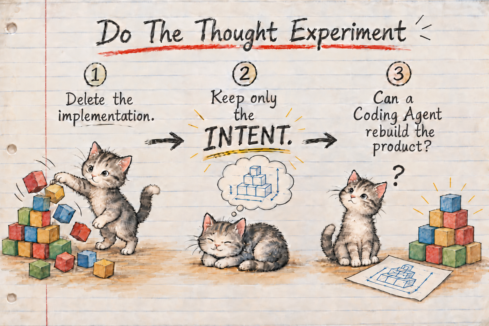

# Intent-Driven Development

<p align="center">
  
</p>

<p align="center">
  <strong>Durable product intent for disposable implementations.</strong>
</p>

[**Explore the interactive IDD diagrams**](https://dimonsmart.github.io/Intent-Driven-Development/) — Overview, Intent Lifecycle, Factory Execution, and Quality & Conformance.

## COSMIC Functional Size Measurement

The read-only `idd-intent-cosmic` command measures COSMIC v5.0 Function Points from current `.idd/intent/` Functional User Requirements. It is separate from qualitative `idd-intent-estimate`: the scope, software boundary, functional users and E/X/R/W movements must be supported by the product specs. It uses mandatory fresh native child readers per spec, bounded hierarchical reducer agents, an independent per-spec coverage ledger, and lossless evidence retained outside the coordinator context. Scratch Markdown packets (when needed) are limited to outside the target repository; no executable validator or custom runtime is required. Results are LLM-reviewed, not independently mechanically validated. For the default whole-product request, the skill must fully read and reconcile every accessible current spec and show per-spec coverage before finishing; merely returning an opportunistic partial subtotal is not completion. Truly unresolved FUR may yield supported subtotals or diagnostics, never a guessed total or effort prediction. See [usage and model limitations](docs/cosmic-functional-size.md).

## What Is Intent-Driven Development?

Intent-Driven Development (IDD) is a lightweight methodology and plugin toolkit for AI-assisted software development.

IDD turns product specifications into durable working memory for Coding Agents. Instead of accumulating plans, task states, review notes, and obsolete implementation details, it keeps a compact and up-to-date description of what the product must do.

Agents get the context they need to understand, implement, and verify changes. Temporary implementation work remains temporary, while Git preserves history.

> **Delete the implementation. Keep only the intent. Can a Coding Agent rebuild the product?**

IDD organizes product knowledge so the answer can move closer to **yes**.

## Why IDD?

- **One current source of product truth.** Intent documents describe what the product must continue to do.
- **Less workflow debris.** Plans, task states, reviews, and implementation attempts do not accumulate in the repository.
- **Lower context overhead.** Agents read relevant current intent instead of a growing archive of workflow documents.
- **Replaceable implementations.** Product knowledge survives refactoring, tool changes, agent changes, and rewrites.
- **Git owns history.** Specifications stay current; Git records how they and the implementation changed.

## Real-world IDD Showcase

IDD is used in substantial public projects, not only small examples. **[CSharpFar](https://github.com/DimonSmart/CSharpFar)** includes a custom terminal window and UI subsystem, dual-panel file management, remote providers, and extensive behavior specifications. **[CSharpGit](https://github.com/DimonSmart/CSharpGit)** applies durable Intent to a cross-platform Git desktop client with history editing, repository-state coordination, and platform-specific presentation concerns.

[Explore the Real-world IDD Showcase](docs/real-world-showcase.md) for real demos, measured source-code scope, and direct links to the projects' current Intent documents.

## Core Intent Plugin and Optional Factory

### `idd-intent` — durable product memory

`idd-intent` is the core IDD plugin. It helps Coding Agents create, maintain, use, and verify the current product intent.

It is a complete standalone plugin and is sufficient for normal IDD workflows. Start here.

### `idd-factory` — lightweight implementation orchestration

`idd-factory` is an optional plugin for larger tasks that benefit from incremental planning and implementation in separate fresh native-agent contexts.

Projects can optionally keep `.idd/engineering/` as their Git-owned durable implementation guardrails and `.idd/verification.yaml` as their operational verification policy. Engineering Rules stay separate from product intent; verification policy keeps repository commands separate from both. `idd-project-init` does not create the optional Engineering layer automatically.

Factory is actively developed with a strong focus on token efficiency. Its primary optimization target is to make structured Factory-driven implementation cost close to equivalent direct Coding Agent commands in token usage — adding control and reliability without turning orchestration into a token multiplier.

The direction is maximum economy: native child agents, no model-driven polling, compact temporary state, minimal handoffs, and only as much orchestration as the task actually needs. Install Factory when that additional structure is useful; keep using `idd-intent` alone when a direct workflow is enough.

<details>
<summary><strong>Why is Factory a separate plugin?</strong></summary>

`idd-intent` is complete on its own. Factory adds orchestration for complex, multi-step work, so you only install it when you need it.

</details>

## Clarification versus Brainstorm

Two optional, read-only Product exploration workflows have different purposes:

- `idd-intent-clarify` narrows one proposed Product requirement, resolves missing behavior and justified complexity, and prepares an explicit confirmation or an already-confirmed specification-ready handoff.
- `idd-intent-brainstorm` explores substantially different strategies and challenges assumptions; it may produce a temporary Decision Brief without selecting a single winner.

Ask naturally to **clarify this requirement**, or to **brainstorm alternative ways to solve this problem**. In Codex the installed `idd-intent` plugin also exposes the skill by its ID; Claude Code can select it automatically through natural language rather than a slash command. Neither skill writes Product Intent, and neither is mandatory before a clear user-confirmed `idd-intent-change`. Only explicitly approved Product decisions may be handed to that owner. Exploratory hypotheses and discussions are not persisted in `.idd/intent/`.

## Business Complexity Assessment

`idd-intent-estimate` assesses the **required target product** from current
`.idd/intent/` specifications, including projects with no code. Its read-only
Markdown report distinguishes **Product Scope** (Small/Medium/Large),
**Implementation Complexity** (Low/Medium/High), and **Assessment Confidence**
(Low/Medium/High), plus seven qualitative complexity dimensions. A preliminary
**COSMIC Preparation** section identifies possible future measurement boundaries
and functional-process candidates without calculating CFP. It does **not**
predict budget, deadlines, effort, remaining work, or code quality.

Ask naturally to *assess business complexity from current Product Intent* or
invoke `/idd-intent-estimate` in Claude Code and select the installed
`$idd-intent-estimate` skill in Codex. Both explicit and automatic invocation
are supported; the command's visibility depends on the host/version. Scope can
be limited to a product area or specific IDD IDs. No Factory plugin is required.

See [Business Complexity Assessment](docs/business-complexity-assessment.md)
for report interpretation, COSMIC boundaries, examples and limitations.

## Visual Intent discovery

`idd-intent-visual-brainstorm` helps turn screenshots, visual inspiration and
UI mockups into user-confirmed visual requirements. It explains professional
design vocabulary in ordinary language and, when available, shows comparison
cards from a bundled Visual Intent Reference Library (or an explicitly supplied project override).

Maintain distributable cards under `src/canonical/visual-intent-library/`:
place `VISUAL_INTENT_CATALOG.md` next to `Images/` and regenerate the plugin.
The installed plugin uses those bundled cards by default; an explicitly
provided local library may override them. No Windows drive is assumed.

Discovery is read-only. After the user confirms which visual qualities are
Essential, Preferred, Free or Avoid, `idd-intent-change` can persist and later
modify/remove the scoped durable meaning in its existing owning specification.
The brainstorm alone does not write Product Intent; confirmed handoffs can be
saved separately without restarting discovery.

Branch development and local validation are documented in
[Testing plugins locally](docs/local-plugin-development.md).
Windows Codex users can switch between published and local IDD using
`scripts/Switch-Idd-Codex.bat published` or `scripts/Switch-Idd-Codex.bat local`.

## Quick Start

Install the core `idd-intent` plugin. For complex, multi-step implementation tasks, you can also install the optional `idd-factory` plugin.

### Claude Code

```bash
claude plugin marketplace add DimonSmart/Intent-Driven-Development@marketplace
claude plugin install idd-intent@intent-driven-development

# Optional: Factory orchestration
claude plugin install idd-factory@intent-driven-development
```

### Codex

```bash
codex plugin marketplace add DimonSmart/Intent-Driven-Development --ref marketplace
codex plugin add idd-intent@intent-driven-development

# Optional: Factory orchestration
codex plugin add idd-factory@intent-driven-development
```

**Factory setup:** Install `idd-intent` and optional `idd-factory` from the
Marketplace, then start a new Codex or Claude session to load the current
Skills. No registration of custom Planner/Worker types, TOML copying or
project/user agent scope selection is needed. Factory creates ordinary
children, which read their internal Skills from the same installed Factory
package. Native child creation, fresh context, access to installed files,
blocking wait and safe cancellation still need host support. The absence of
`agent_type` in Codex Desktop is not itself a blocker. See
[Factory installation and capabilities](docs/factory-native-agent-installation.md).

Questions about IDD itself can be addressed at any time by manually invoking `idd-help`. Use it to ask how the methodology works, why a workflow is chosen, what a skill does, or how a particular IDD rule should be interpreted.

```text
idd-help Why does this change need an intent update?
```

Open the target repository and initialize IDD:

```text
idd-project-init
```

For an existing implementation without current intent documents, initialization can offer the interactive `idd-intent-bootstrap` workflow to analyze the project and propose its initial intent model.

Then describe what you need naturally. The Coding Agent selects the applicable
registered workflow automatically. For example:

```text
Help me clarify a feature that lets users compare two local folders without modifying either side. Do not change files yet.
```

For complex implementation tasks, use `idd-factory-run` after installing the optional Factory plugin above.

## Commands, automatic workflows, and internal agents

IDD distinguishes three kinds of capabilities:

- **User commands** are the five IDD Intent skills intended for direct invocation:
  `idd-help`, `idd-project-init`, `idd-verification-configure`,
  `idd-glossary-build`, and `idd-skip`. The optional Factory plugin adds
  `idd-factory-run` and `idd-factory-configure` (setup, exact edits, review,
  and model refresh).
- **Automatic workflows** are registered skills selected by the Coding Agent from
  a natural-language request (for example: `idd-route`, intent change, import,
  lint, conformance audit, or implementation). `idd-route` is an internal
  read-only classifier, not a separate user command. To inspect a route, ask
  naturally which workflow would apply and explicitly say not to execute it.
- **Internal Factory Skills** are the canonical Planner/Worker protocols in
  the Factory package. Generic native child agents load them independently;
  Root provides the installed Skill paths and bounded assignments, not bodies.
  Intent document creation remains owned by its existing workflows.

Claude Code hides automatic workflows from the slash-command menu but retains
model invocation. Codex retains all registered skills and implicit invocation;
its current skill metadata has no equivalent guaranteed user-menu visibility
control. Hiding a command does not change manual-only invocation restrictions.
Describe the outcome and scope instead of invoking hidden Claude skills
directly. See [IDD Use Cases](docs/using-idd.md) for examples.

## Update an Existing Installation

Already have `idd-intent` or `idd-factory` installed? Follow [Updating IDD](docs/updating-idd.md) to refresh the marketplace, update or reinstall the plugins, verify the installed versions, and load them in a new session.

Updating the plugin does not automatically migrate project-owned intent documents. Review [Updates and Breaking Changes](docs/updates-and-breaking-changes.md) for repository migration instructions.

## Use Cases

Open [IDD Use Cases](docs/using-idd.md) when you need to decide what to do next. It covers existing and new projects, product changes, implementation-only work, audits, verification, Factory, installation checks, updates, and deliberate IDD bypass.

## Updates and Breaking Changes

Release-specific migration instructions are maintained on the dedicated [Updates and Breaking Changes](docs/updates-and-breaking-changes.md) page.

## Documentation

- [Business Complexity Assessment](docs/business-complexity-assessment.md)
- [Real-world IDD Showcase](docs/real-world-showcase.md)
- [IDD Use Cases](docs/using-idd.md)
- [Engineering Guardrails](docs/engineering-guardrails.md)
- [Verify Installation](docs/verify-installation.md)
- [Updating IDD](docs/updating-idd.md)
- [Updates and Breaking Changes](docs/updates-and-breaking-changes.md)
- [Factory Workflow](docs/factory-workflow.md)
- [Factory Native Agent Installation & Limitations](docs/factory-native-agent-installation.md)
- [Factory Workflow Configuration](docs/factory-workflow-configuration.md)
- [Existing Project Guide](docs/existing-project.md)
- [New Project Guide](docs/new-project.md)
- [Methodology](docs/methodology.md)
- [Interactive IDD Overview](docs/diagram/README.md)
- [Factory Skills Reference](docs/factory-skills.md)
- [Factory Token Efficiency & Benchmarking](docs/factory-token-efficiency.md)

### For contributors and maintainers

- [Project Maintenance](docs/project-maintenance.md)

## License

MIT
